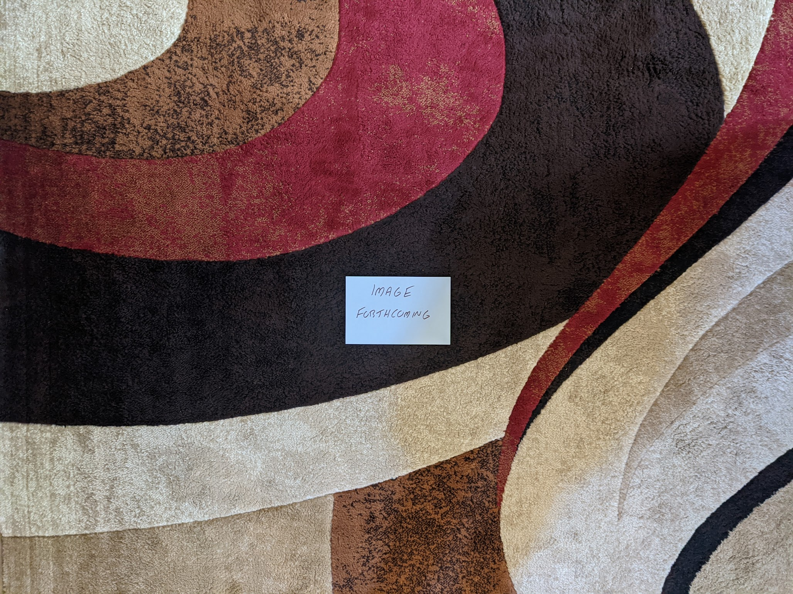

1987 Albums
-----------

This was the year that my family got cable TV and I had access to MTV for the
first time. This was still very much the era where they were playing 95% music
videos and for the first time there was a music discovery path outside of my
older siblings' music collections. The music of this era makes me think of the
much simpler times of childhood

Compiling this list of favorites has made me realize that my taste in 80s music
is more diverse and scattered than any other decade. In later years, I would
mostly be interested in alternative/indie, and in the early decades I lean
heavily into classic rock. Throughout the 80s, my favorites come from a wide
swath of the pop music spectrum and the list below really makes this very clear.
In general, the mid-80s were a time when a lot of different things were getting
played on the radio, or perhaps even more importantly, MTV. In a way, this also
might be the year that my tastes align most closely with the most popular music
of the day. Perhaps these two things are directly related.

.. raw:: html

  <iframe data-testid="embed-iframe" style="border-radius:12px"
  src="https://open.spotify.com/embed/playlist/2eFfm209NMd4z5zrpSxqjs?utm_source=generator"
  width="100%" height="352" frameBorder="0" allowfullscreen="" allow="autoplay;
  clipboard-write; encrypted-media; fullscreen; picture-in-picture"
  loading="lazy"></iframe>
  
- *Kiss Me, Kiss Me, Kiss Me* by **The Cure** - This might be a little too long,
  and there probably is a really strong single album here. That said, the band
  seems to be working things out here, to transition from the sparer gothic
  sounds of their early records, and the (somewhat) brighter, pop songs to
  follow. Perhaps the double album was required for them to fully explore
  the contrasting approaches that would define both eras. Mostly remembered for
  the massive hit and classic song "Just Like Heaven", I now enjoy it mostly for
  the trademark, extended **Cure** atmospherics that stitch together the short
  form pop songs. [*Memory*: I really connected with this one after I picked up a
  Record Store Day reissue of it in 2013.]

- *Within the Realm of a Dying Sun* by **Dead Can Dance** [**1987 FAVORITE**] -
  This is the most goth record ever made. A stunningly beautiful collection of
  orchestral atmospherics, it is fairly unique in the history of music. Without
  question their finest moment as a duo, it also captures the best moments from
  each of the two vocalists. Album closer "Persephone (The Gathering of
  Flowers)" is the best summary of what made these guys great, and the absolute
  peak of their incredibly strong series of albums

- *Music for the Masses* by **Depeche Mode** - Perhaps the album that best
  captures their trademark sound, even if their later more diverse works were a
  bit better overall. This is the best presentation of the hard edged,
  industrial tinged synth-pop that dominated their early work, and would alway
  be under the surface as they continued to mature as a band. Opener "Never Let
  me Down" is a massive compositional success, and the blueprint for the music
  that would take them to new heights on the next record. Every DM album is
  required to have a beautiful little Martin Gore sung ballad, and we have it
  here in "I Want You Now". [*Memory*: This was the last of their classic albums
  I acquired on CD, and the last one I repurchased on vinyl. I don't know why,
  as I really like it.]

- *Echo & The Bunnymen* by **Echo & The Bunnymen** - The last of five great
  records to kick things off, and they would never make anything this good
  again. Mostly famous for the hit "Lips Like Sugar", but there are some other
  great tracks here, especially "Bring on the Dancing Horses". Perhaps they were
  becoming a little too refined, and loosing touch with the edge that made them
  great, but there is the first small indications of filler here. [*Memory*:
  This is one of those records I bought early in my vinyl collecting days,
  without having heard it before. It became a favorite probably because of the
  engagement the format created.]

- *The Innocents* by **Erasure** - A joyous and fun bit of synth-pop. The more
  jaunty aspects of **Depeche Mode** definitely went along with Vince Clarke.
  This will always be mostly famous for the first track an lead single, "A
  Little Respect", but the whole thing is strong from beginning to end. "Ship of
  Fools" could have been a track off of the first two DM albums, and "Chains of
  Love" is an amazing throwback to to kind of soulful electronic pop that was en
  vogue in the first half of the decade. [*Memory*: I remember my sister
  listening to this all the time in the late 80s. It was one of the first CDs
  that made it into our house soon after the format took hold.]
  
- *Cloud Nine* by **George Harrison** - It had been a really long time since he
  had released a great album, and thanks to the input of **Jeff Lynne** this is
  a real winner. This will always be mostly remembered for the massive hit cover
  of "Got My Mind Set On You" and to a lesser extent the **Beatles** nostalgia
  piece "When We Was Fab", but the whole thing is solid. We get some inspired
  George Harrison style guitar solos on the title track and "This is Love". The
  influence of Lynne is unmistakable and wonderful. He is an overbearing, but
  highly effective influence in the studio. [*Memory*: My sister bought a vinyl
  copy of this, but I don't really remember listening to it much at the time. I
  remember buying a copy of it early in my CD collecting days, and remember
  thinking it sounded vaguely like my favorite **Tom Petty** record, *Full Moon
  Fever*. That is the Jeff Lynne effect.]

- *Whitney* by **Whitney Houston** - One of the greatest albums in mainstream
  pop history, it is solid from beginning to end. "I Wanna Dance with Somebody"
  is an all time classic of dance-pop, and a stellar production. The ballads are
  the most remarkable specimens of adult contemporary radio, especially "Didn't
  We Almost Have it All". My favorite track will always be the New Jack preview
  of "So Emotional" a track that still feels fresh and exciting nearly 40 years
  later. [*Memory*: I remember the video for "I Wanna Dance with Somebody" still
  playing repeatedly on MTV when we would get cable a year after its release. At
  the time I remember thinking the song was really old. Time works different
  when you are a kid.]

- *Kick* by **INXS** - Probably the definitive record of 1987. These guys did an
  amazing job of aggregating the best moments of mid-80s alternative rock and
  refining it into something that was ready made for the Billboard charts. This
  is the kind of highly refined, synthesized rock music that has been coming out
  of Australia since the beginning of rock. That isn't to say it is derivative,
  so much as to say it is a reflection of the best aspects of cotemporary
  trends from the other side of the world. Very much a product of its time, but
  it holds up great all these years later. [*Memory*: I think this might be the
  first time that I had a profound connection with the contemporary rock music
  of the day. I remember the video for "Need You Tonight" playing incessantly on
  MTV in early 1988, and I dug it. I especially remember connecting immediately
  with the slower, more soulful "Never Tear Us Apart" though its distinctive
  video. I tried to get my siblings to buy a CD copy of "The album with the
  skateboard on the cover". I remember some confusion with another record from a
  hair metal band of the day (possibly **Kix**, but I have never found the album
  if so). Eventually, my sister did buy a copy, and it became one of my
  childhood favorites. Their funky, soulful brand of new wave had a big
  influence on the music I would listen to later in life.]

- *Bad* by **Michael Jackson** - The cross-over is complete with this massive
  hit record. While *Thriller* still had the trappings of the Motown scene that
  produced him, this is very much a mainstream pop radio album, and it is a darn
  fine one. This is also the record where the idiosyncrasies both musical and
  aesthetic start to dominate the proceedings. The man would soon be consumed by
  the excesses of his own mythology, but he would create one last masterpiece
  before fading slowly into oblivion. [*Memory*: This was the first Michael
  Jackson album cycle that I can clearly remember as a kid. The singles off of
  this were everywhere. The video for "Smooth Criminal" was on MTV non-stop in
  late 1988.]

- *Running in the Family* by **Level 42** - For me, this will always be the
  ultimate album on the synth heavy side of sophista-pop. It is the kind of
  smooth, jazzy, ultra-produced music that is so cheesy and dated that it
  somehow becomes timeless. It is always a little shocking that David Foster was
  not involved in this, especially the title track which seems to carry his
  fingerprint strongly. "It's Over" feels like a fully transparent effort to
  recreate the torch song magic of "Leaving Me Now", but from the other side of
  the story, and it works out perfectly. [*Memory*: My brother bought a
  compilation CD of these guys in the early 90s. I made fun of it mercilessly
  for being cheesy. I still think it is cheesy, but I now understand it is also
  beautiful and incredibly well done.]

- *Let it Loose* by **Miami Sound Machine** - The last album before **Gloria
  Estefan** would emerge as a solo artist separate from her band is a preview of
  that career to come, with a distillation of what made the group work well.
  This is slickly produced, Cuban influenced, dance-pop. The monster hit "Rhythm
  Is Gonna Get You" feels like a incremental improvement on the hit "Conga" from
  the last record. Many of the tracks turn down the tempo on ballads that point
  forward to the solo career to come, most successfully on the soft rock radio
  smash "Can't Stay Away From You". [*Memory*: There are two records that I
  strongly associate with the CD format: The *Cocktail* soundtrack and this
  release. They were two of the very first discs my brother bought and listed to
  on his new HiFi in 1988. The super-scrip, somewhat artificial production of
  this album is the perfect showcase for the lack of surface noise and digital
  sound reproduction that that format offered. I remember messing with the Dolby
  Surround Sound controls to create all sorts of weird echos and effects when
  listening to "Rhythm is Gonna Get You". My brother had bought a vinyl copy at
  release, and is a testament to how much he like these guys that he repurchased
  it on CD about a year later.]

- *Faith* by **George Michael** - We saw flashes of brilliance in the last years
  of **Wham**, but the full pop genius is on full display here. At the time it
  was easy to write him off as a manufactured pop idol, but in retrospect it is
  hard to see him as anything other than an underappreciated musical genius. The
  soulful pop songwriting mastery is most clear in the subtler moments of
  "Father Figure" and especially "One More Try". [*Memory*: My sister loved this
  album in 1987. Everybody's sister loved this album in 1987. The song "Faith"
  is one of two songs (along with **Belinda Carlisle**'s "Heaven is a Place On
  Earth") that helps me date when we got cable. In those day's MTV would make a
  big premiere in the prime time block for new videos entering the rotation. I
  remember the introduction of those two songs in the early days of me watching
  MTV. That indicates we got cable in the late summer of 1987.]

- *Substance* by **New Order** - In general I have avoided compilations on this
  list, but I need to make an exception here. For me, they never made a great
  album, and their best work were the 12" club mixes. That is what we have here,
  and just about every track is a classic. [*Memory*: In the era of polyphonic
  ringtones (early 2000s), a midi of "Bizarre Love Triangle" was my ring.]

- *Actually* by **Pet Shop Boys** - I love their debut, but this is my absolute
  favorite of theirs. Crisp songwriting on tracks like "Rent" and "It's a Sin"
  solidify their status as the finest creators of thinking person's dance music.
  The slower "It Couldn't Happen Here" shows a whole new side of the artist that
  would be expanded upon in the years to come. The **Dusty Springfield** collab
  "What Have I Done to Deserve This" is one of the all time great pop singles.
  [*Memory*: I went to the recently relocated Bop Shop to buy a vinyl copy of
  this in 2012 shortly after seeing their memorable performance in the London
  Olympics closing ceremony.]

- *Sign "O" The Times* - **Prince** - Like many double albums, this could be cut
  down into one of the greatest single volume efforts in history. That said, it
  is hard to know exactly what filler to cut. Maybe this needs to be a
  sprawling, uneven affair. The highs are extremely high, with "U Got The Look"
  being perhaps the greatest realization of the early **Prince and the Revolution**
  sound. (Although, this album is unfortunately also where that band imploded,
  and I really wish it was Wendy singing those lyrics instead of **Sheena
  Easton**.) There are some really out there experiments on this record, and
  some of them really work like "If I Were Your Girlfriend". [*Memory*: When I
  was completing my collection of my favorite Prince records in 2016, this was
  the first one that I couldn't find in a store and had to buy via Discogs. I
  remember being unsure about paying the princely sum of $35 for the double
  album. Those were different times!]

- *Freaks* by **Pulp** - I think a lot of people don't understand that
  self-satire and self-deprecation have been a large part of the goth scene
  since its inception. So in a way, this fits right in with the rest of the
  scene. They would only play around in this space for this single, commercially
  irrelevant album, and we would know nothing of this if it hadn't been for
  their later BritPop success. That said, it manages to be my second favorite
  album by then, and I am one of a very small group who see this is as a
  classic. The vocal performance on "I Want You" is one of the finest in
  **Jarvis Cockers** long career. The claustrophobic horror of "Being Followed
  Home" is creepy and effective. The intense psychedelic grandeur of "The Never
  Ending Story" is unlike anything else in their catalog, and perhaps the
  history of rock music. [*Memory*: I don't know what made me want to explore
  their back catalog in the summer of 2020, but I'm glad it led me to this lost
  masterpiece.]

- *Document* by **R.E.M.** - Their commercial breakthrough is a mixture of their
  edgier early sound, and the twangy alt rock to follow. A much cleaner
  production than their first four records, this sounds like a polished band
  prepared for the MTV spotlight. [*Memory*: When I was young, I would have said
  this is my favorite of their albums. I find myself returning to it less these
  days. Perhaps I have listened to it too much over the years.]

- *Pleased to Meet Me* by **The Replacements** - Their last classic album is
  filled with the kind of roots rock and power pop influences that would typify
  their later work. There is still just enough of that punk edge here to keep me
  interested, but I can generally go no further into their catalog. "Alex
  Chilton" is an amazing song, and a homage to a clear influence on this phase
  of the group's output. [*Memory*: For some years, I thought of this as the
  album with "Alex Chilton" but never really gave it a proper listen due to
  my skepticism for their latter day work. Will my opinion of the last two
  records change someday as well?]

- *Floodland* by **Sisters of Mercy** - For me, this is the definitive article
  of goth rock. With the nearly 10 minute epic "This Corrosion" being the
  absolute peak of the movement. Their great innovation was the integration of
  electronic dance music into goth and this is where it started. Yes it is a bit
  dated, but in the most wonderful way possible. [*Memory*: Around 2007 I bought
  the Rhino *Goth Box* as my point of entry to the scene. On the DVD disc, I saw
  the memorable video for the slow churning track "Lucretia My Reflection" and
  it was an amazing introduction to these innovators of the form.]

- *Strangeways, Here We Come* by **The Smiths** - This is one of those final
  albums that records a band taking their sound in a myriad of new directions.
  They were bursting with ideas that seemed to imply a range of possibilities,
  but also seems to indicate a group of musicians who no longer had a unified
  approach to music. It is really easy to hear the foundations of the
  **Morrissey** solo career in tracks like "I Started Something I Couldn't
  Finish" and especially "Last Night I Dreamt That Somebody Loved Me". They
  never made an album that wasn't great, and it is a shame that we didn't get to
  see where all this was leading. [*Memory*: For a long time, I resisted adding
  their records to my lists of favorites. I had convinced myself that I was more
  of a fan of the Morrissey's solo work. It was this final statement that
  convinced me that their catalog also stood among my favorites.]

- *Louder Than Bombs* by **The Smiths** - They have so many amazing non-album
  singles that you need two different compilations to get them all. This
  includes much of their finest work that didn't appear on albums, including:
  "Sheila Take a Bow", "Shoplifters of the World", "Panic" and "Shakespeare's
  Sister". In some ways, this ends up being their strongest release. [*Memory*:
  When I was younger I had "The Smith's Greatest Hits" and it always burned me
  that I needed two vinyl releases to get what was on that record. I didn't
  realize all the great tracks I was missing until I picked up a copy of this.]

- *Tunnel of Love* by **Bruce Springsteen** - He does an amazing job turning the
  dial down after the arena rock anthems of *Born in the U.S.A.*. An understated
  album of relationship songs, highlighted by the "Brilliant Disguise", and
  "Cautious Man", which is my favorite song of his and one of my favorite songs
  of all time. This is the last of his records that makes my list, but it is the
  end of a seven album run that is among the finest in rock history. [*Memory*:
  For many years I couldn't get into this, and it took until my late 30s to
  accept this as part of the golden age of the Boss.]

- *The Cost of Loving** by **The Style Council** - I love this record in a way
  that puts me into the 98th percentile of their fanbase. It has long been
  acceptable to like the early records that were made in the shadow of **The
  Jam**, but this latter day sophista-pop gem is largely unloved. I really dig
  the slickly produced, soulful tunes on this one, especially "It Didn't Matter"
  and "Waiting". This will never be cool to like, but I don't care. [*Memory*:
  The reputation of this album always kept me from exploring it. I even owned
  the comprehensive box set for the group, but always avoided this latter work.
  It wasn't until the fantastic documentary and compilation in 2021 that I
  allowed myself to full engage with this one. It not only made me appreciate
  this album, but kicked off an exploration of the much maligned genre of
  sophista-pop.]

- *Make it Last Forever* by **Keith Sweat** - The definitive statement from the
  softer side of New Jack Swing. That title track is an all time classic slow
  jam on an album that is bursting with them. Like most of the best work from
  the genre, this album manages to still feel like it is coming from the future.
  [*Memory*: During my second period of intense interest in New Jack Swing, I
  sought out cassette copies of my favorite albums in the genre. This was one of
  the very first I had to have. I now also own a minty vinyl copy.]

- *It's Better to Travel* by **Swing Out Sister** - If I were to pick the album
  that most defined the sophista-pop genre, it would be this one. We have some
  very legit jazz vocals here, with lots of scat. The music is a very complex
  kind of new wave, with all the trappings of the age: synth bass, general midi,
  and of course a drum machine, but yet, very much in line with jazz structure
  and sensibilities. "Breakout" was well, the breakout hit, but the whole album
  is quite solid. Incredibly dated, but joyous and sincere, this is one of my
  favorite bits of late 80s nostalgia. [*Memory*: **The Style Council** were my
  gateway, but this album was the start of my deep journey into sophista-pop in
  the Autumn of 2021. I was waiting in line at the Walgreens Pharmacy on Monroe
  Avenue when I heard "Breakout" on the store speakers. That is just about the
  best song you will ever hear in the context of a drug store, and it made me
  investigate the band, and their genre further. From there I found a Spotify
  playlist made by a random Swedish guy that became the basis for my early
  explorations. It led me to latter day work by bands I already loved like
  **Roxy Music**, but also introduced me to a ton of new artists, and their
  landmarks albums that now make this list. ]

- *They Might Be Giants* by **They Might Be Giants** - One of those debuts that
  shows a band at peak energy, bursting with new ideas and concepts for what
  rock music can be. The album is comprised of the kind of crisply written pop
  songs that you rarely see outside the realm of commercial jingles, but here
  the Johns turn their pop genius to a far reaching collection of topics from
  the absurd to the profound. Alas, like many of the classic debuts, they
  would never quite have that same energy again. The song "She's An Angel" is my
  absolute favorite from their catalog, and it is based on absurd pun that is
  the perfect encapsulation of what makes them amazing songwriters. [*Memory*: I
  was very into this album around the time I relocated to Rochester, NY. It
  reminds me of moving into my tiny little apartment on Harvard street, and
  going to see them at the Harro East Ballroom.]